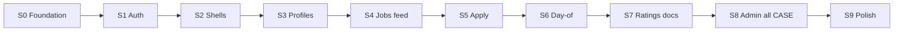

# 11 — Subagent orchestration (full monorepo build)

**Status:** `accepted`  
**Last updated:** 2026-10-11  
**Parent:** [`AGENTS.md`](../AGENTS.md) · playbook [`01-implementation-playbook.md`](01-implementation-playbook.md)  
**Tracking file:** [`../../.parton/orchestration-state.json`](../../.parton/orchestration-state.json)

> One **orchestrator** (parent agent) owns slice order, merge conflicts, and gates. **Child subagents** get a single slice or bounded surface; they must not re-decide ADRs, invent routes/screens, or ship mocks.

---

## 1. Roles

| Role | Cursor subagent | Owns |
| --- | --- | --- |
| **Orchestrator** | Parent (this session) | Slice queue S0→S9, `orchestration-state.json`, merges, CI, credential asks (once) |
| **Foundation** | `generalPurpose` | S0: Bun/turbo, host/managed Postgres, packages, Nest bootstrap, PM2/NGINX templates |
| **Backend domain** | `generalPurpose` | S1–S7 Nest modules, Prisma, REST, integration tests |
| **Explore / grep** | `explore` (medium+) | Route/screen/case traceability before coding |
| **Mobile** | `generalPurpose` | S2/S6: bare RN, NativeWind, Fastlane, `m.*` screens |
| **Web admin** | `generalPurpose` | S2/S8: Vite shadcn, `w.admin.*` matrix |
| **Marketing** | `generalPurpose` | S2: `apps/marketing` production prerender |
| **DevOps MCP** | `generalPurpose` | S8: `apps/devops-mcp` per [web/10](../web/10-devops-mcp.md) |
| **Code intelligence** | Parent uses **codebase-memory-mcp** (not a Task child) | `index_repository`, `search_graph`, `get_architecture` on `PartonNewArch` + `apps/` |
| **Verify handoff** | `codebase-memory` / Scout / Verify (read-only) | Coverage checks when parent delegates doc-only audits |

Subagents **must** read before write: slice row in [`05-slice-catalog.md`](05-slice-catalog.md), [`07-anti-hallucination.md`](07-anti-hallucination.md), [`08-no-mocks-fully-functional.md`](08-no-mocks-fully-functional.md).

---

## 2. Slice waves (dependency order)



| Wave | Slice | Parallel children allowed | Exit gate |
| --- | --- | --- | --- |
| 0 | S0 | 3: contracts package, backend skeleton, deploy templates | `GET /api/v1/health/ready` 200 + Postgres |
| 1 | S1 | 1 (auth is sequential) | OTP SMS sandbox → verify → `/me` |
| 2 | S2 | 3: mobile, admin, marketing | iOS+Android login shell; admin login; marketing prerender |
| 3 | S3 | 2: worker path, employer path | Wizards + policies accept |
| 4–7 | S4–S7 | 1 domain slice per agent | Case tags green in integration tests |
| 8 | S8 | 2: admin UI matrix, devops-mcp | web/08 rows + MCP tools auth |
| 9 | S9 | 1 | PM2/NGINX/load-test skeleton |

**Rule:** Do not start wave *n+1* until wave *n* exit gate passes (orchestrator runs commands).

---

## 3. Child prompt template

```text
Full Repository Path: /root/PartOnUpdated
Slice: S{n} — {title} (agents/05-slice-catalog.md)
Read: AGENTS.md, agents/07, agents/08, agents/09, agents/04, DESIGN.md (if UI), listed docs in slice catalog.
Bans: Expo, GraphQL, RabbitMQ, mocks/noops, invented screen IDs.
Defaults: agents/02-defaults-and-non-asks.md — do not ask user for stack.
Deliver: working code only; no TODO/FIXME stubs; fail boot if required env missing.
Cases: list T-### tags in commit message.
Report: files touched, commands run, exit gate evidence.
```

---

## 4. Orchestrator checklist (each slice)

1. Update `.parton/orchestration-state.json` → `in_progress`  
2. `explore` agent: confirm routes/screens exist in docs for this slice  
3. Dispatch `generalPurpose` child with template §3  
4. Run: `bun run setup` (`scripts/install.sh`), `bun run typecheck`, `bun run test` (slice scope); mobile slice: `cd apps/mobile && npm test`  
5. Data: ensure `DATABASE_URL` reaches host/managed Postgres; `bun run db:migrate` if backend touched  
6. Mark slice `done` + commit message conventional + case IDs  
7. Re-index: `codebase-memory-mcp cli index_repository --repo-path /root/PartOnUpdated --name PartOnUpdated`

---

## 5. Credentials (ask once)

| Secret | Used in | If missing |
| --- | --- | --- |
| `DATABASE_URL` | All | Host or managed Postgres — see [`docs/DEV.md`](../../docs/DEV.md) |
| `JWT_*` | Auth | Generate in `.env.example` instructions |
| `TWILIO_*` or `NETGSM_*` | OTP SMS | **Fail boot** — no ConsoleSms |
| `FCM_SERVICE_ACCOUNT_PATH` | Notify S5+ | **Fail boot** when notifications module loads |
| `S3_*` | Documents S7 | S3-compatible endpoint on host or cloud |

---

## 6. Anti-patterns

| Do not | Do instead |
| --- | --- |
| Multiple children editing same Nest module | Serialize by module or merge in orchestrator |
| Child claims tests passed without log | Orchestrator re-runs |
| Placeholder `throw new Error('TODO')` in prod paths | Implement or exclude route until slice owns it |
| Invent `m.foo.bar` | Use catalogs under `mobile/screens/` |

---

## Related

- Playbook: [`01-implementation-playbook.md`](01-implementation-playbook.md)  
- Slices: [`05-slice-catalog.md`](05-slice-catalog.md)  
- Start prompts: [`06-start-prompts.md`](06-start-prompts.md)
